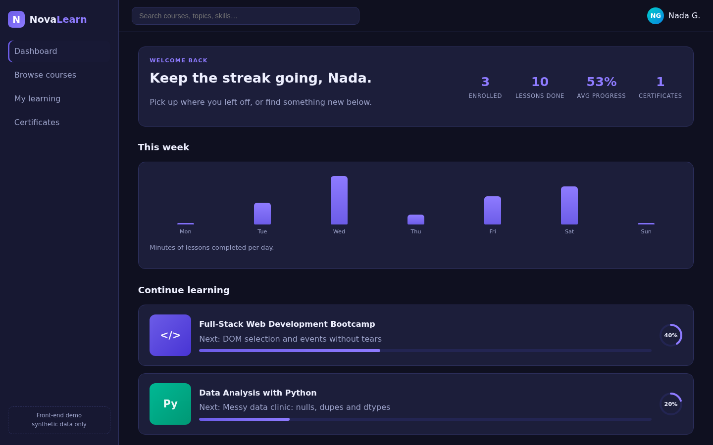
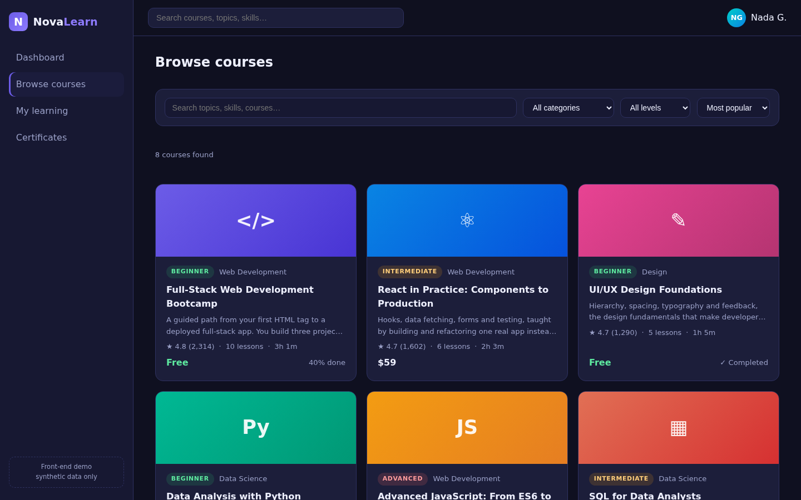
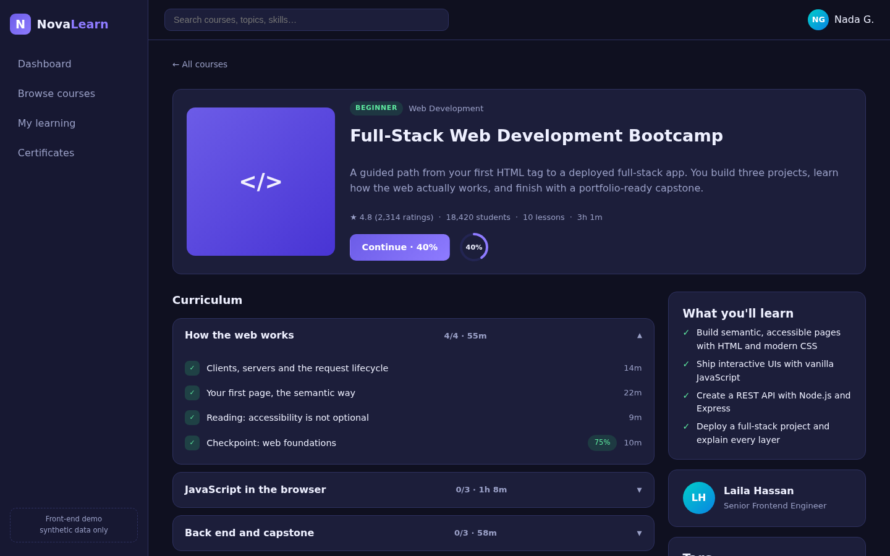
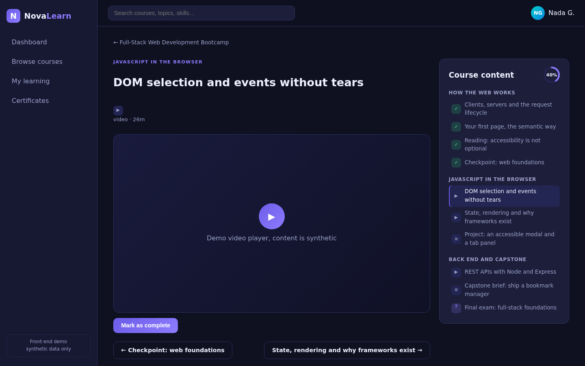
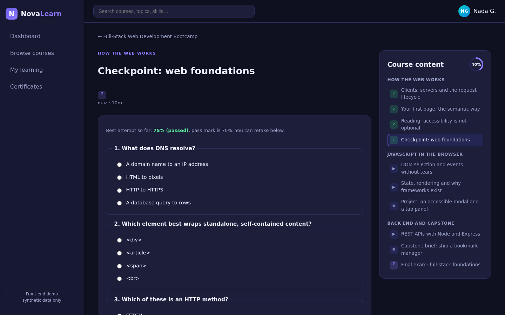
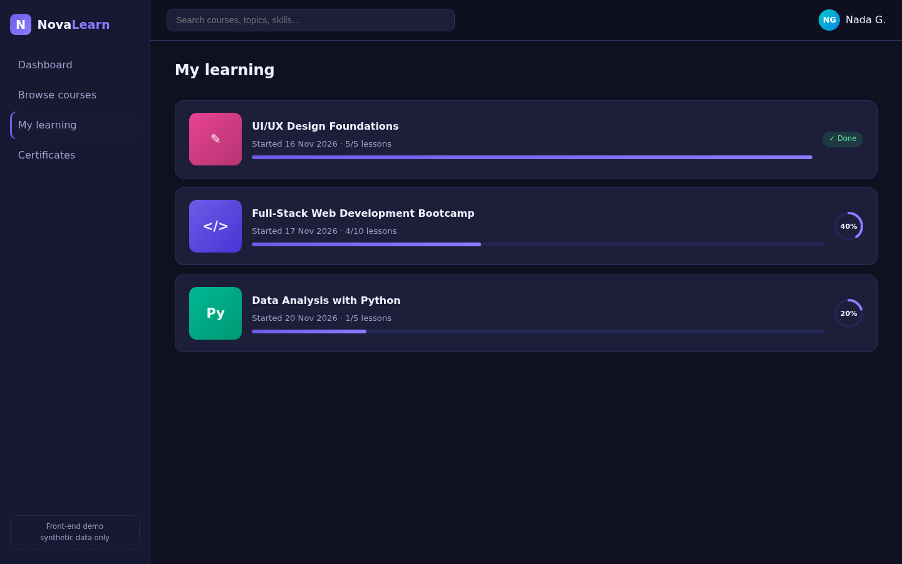
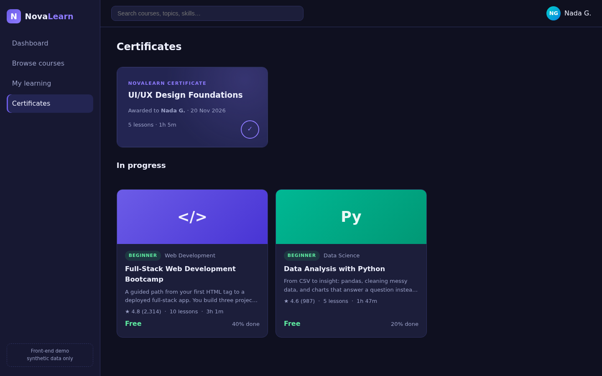

# NovaLearn: Learning Management System (front-end demo)

A complete LMS front end: course catalog with search and filters, curriculum
with modules and lessons, a quiz engine with a pass mark, progress tracking,
weekly activity stats, and certificates. Built with vanilla ES modules, no
framework, no build step, so it runs anywhere a static file server runs.

All content, instructors, ratings and student counts are **synthetic sample
data** for demonstration. Progress is stored in `localStorage` only.

## Screenshots

| Dashboard | Course catalog |
|---|---|
|  |  |

| Course detail | Lesson player |
|---|---|
|  |  |

| Quiz | My learning |
|---|---|
|  |  |

| Certificates |
|---|
|  |

## Run it

```bash
# any static server works; from the project root:
python3 -m http.server 4173
# or: npx serve .
```

Open http://localhost:4173

## Run the tests

```bash
npm test        # node --test, no dependencies required
```

## Features

- **Dashboard**, enrollment stats, average progress, lessons completed,
  certificates earned, and a weekly activity chart derived from completion
  timestamps (empty state when there is no activity).
- **Catalog**, full-text search across titles, descriptions, tags and levels;
  category and level filters; sorting by popularity, rating or title.
- **Course pages**, outcomes, instructor card, module accordion with
  per-module progress, lesson types (video / article / quiz), best quiz score
  chips.
- **Lesson player**, video placeholder, article reader, previous/next
  navigation, mark-as-complete, and a full table of contents with live progress.
- **Quiz engine**, required answers, per-question explanations, pass mark of
  70%, best-score retention, retakes, and automatic lesson completion on pass.
- **Certificates**, earned when every lesson in a course is complete, with the
  completion date.
- **My learning**, all enrollments with resume links and progress rings.
- Responsive layout (sidebar collapses to a menu under 900px), dark original
  design, accessible touches (focus outline, ARIA labels, semantic landmarks).

## Architecture

```
index.html            shell: sidebar, topbar, #view container
assets/css/styles.css design system (custom properties, components, responsive)
src/data.js           synthetic catalog: 8 courses, modules, lessons, quizzes
src/utils.js          formatting, clamp, slug, search helpers      (pure)
src/progress.js       progress + stats + weekly activity math      (pure)
src/quiz.js           quiz scoring + validation                    (pure)
src/store.js          localStorage persistence (enrollments, scores)
src/app.js            hash router, view rendering, event handling
tests/                node:test unit tests for the pure modules
```

The pure modules (`utils`, `progress`, `quiz`) contain all the logic worth
testing and are imported both by the browser app and by the Node test runner,
so the tests exercise the same code the UI runs.

## What is real vs. demo

- Real: routing, filtering, search, progress math, quiz scoring, persistence,
  responsive layout, certificates logic.
- Demo/synthetic: course content, instructors, ratings, student counts, and
  the video player (a styled placeholder). There is no backend; nothing leaves
  the browser.

## Possible next steps

- Wire a real API behind `store.js` (the UI only talks to that module).
- Add note-taking per lesson and a discussion thread mock.
- Export progress as JSON for an instructor dashboard view.
